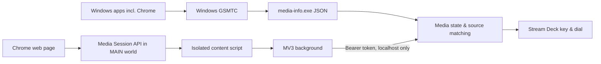

# Stream Deck Media Controls v0.2 (Windows + Chrome metadata)

A source-only prototype of Stream Deck media controls that displays **Windows GSMTC and optional Chrome Media Session metadata**. It extends the earlier 8 media-key actions with **Now Playing (artwork)** and **Now Playing + (dial/seek-progress view)**.

> Status: Chrome JavaScript syntax, JSON manifests and asset references were checked in the author's non-Windows environment. **Windows Rust compilation, Stream Deck SDK TypeScript compilation, Chrome integration and real device operation have NOT been tested.** This ZIP is **source code, not a ready-to-install `.streamDeckPlugin` package**. Treat it as a development preview.

## Scope

- Windows: GSMTC current session and available sessions, app user model ID, title, subtitle, artist, album artist, album title, track number/count, genres, playback type, playback status/rate, shuffle, repeat, available playback controls, seek timeline and native thumbnail if present.
- Chrome extension (optional): page Media Session title/artist/album, artwork candidates (size and MIME), playback state, playback rate, position/duration (HTML media or `setPositionState` when observable), tab URL/title, HTML media element's muted/volume/loop/ended/readiness/PiP/buffered/seekable (when accessible).
- Merged primary display: Windows current session is authoritative. Chrome can fill missing artist/album and improve artwork **only when the Windows current session is Chrome and the titles/available artists match**. When Windows has no current session, Chrome metadata is shown on its own.
- Stream Deck: `Now Playing` (artwork, title, key to play/pause), `Now Playing +` (artwork/position/progress with encoder; rotate volume, press play/pause), and the original 8 actions.
- The collected data is a *superset* of what can fit on one Stream Deck key. For diagnostics the `media-info.exe` native helper prints JSON including all GSMTC sessions.

**Not implemented in this prototype:** Windows Core Audio endpoint volume read-back / per-process volume mixing, selectable multiple media sessions, website-specific metadata scrapers, accurate buffered/seek UI per site, direct per-session transport commands, cover art for every site, lyrics/chapter support, sound capture or DRM bypass. The existing media controls use global media key events, not exact-session targeting.

## Requirements

- Windows 10 **1809 or later**, Windows 11 recommended
- Stream Deck software 7.1+
- Node.js 24 and npm
- Rust stable (`cargo`) with Windows MSVC build tools / matching toolchain
- Stream Deck CLI `@elgato/cli`
- Chrome / Chromium for optional browser enrichment

## Build on Windows

```powershell
npm install
npm install -g @elgato/cli@latest
npm run check
npm run link
npm run restart
```

If the GSMTC Rust binary fails to compile, inspect `native/media-info/src/main.rs` and its `windows = "0.62.2"` API version. The Windows compile step must be executed on Windows; the source-only ZIP contains no EXEs.

Check the native information stream after a successful build:

```powershell
.\dev.local.media-controls.sdPlugin\native\media-info.exe
```

This prints one JSON object containing `current` and `sessions`. An application may omit fields; a missing thumbnail is represented as `null`. Unlike the Stream Deck visual surface, this JSON can preserve all supported fields.

## Optional Chrome extension setup

1. Start the Stream Deck plugin. This starts a **localhost-only** receiver on `127.0.0.1:39761`.
2. In Chrome open `chrome://extensions`, enable **Developer mode**, click **Load unpacked**, and choose the folder `chrome-extension`.
3. Open the extension's **Options**.
4. On Windows, open `%LOCALAPPDATA%\StreamDeckMediaControls\chrome-token.txt`, copy its 64-character hexadecimal token into extension Options and enable bridge sending.
5. Open an audio/video site. Start playback and place the `Now Playing` action on your Stream Deck. The extension provides extra details and images if available.

The connection token is a local bearer secret. **Do not share it** or commit it to a public Git repository. The Chrome extension has **broad website access** to capture Media Session metadata on arbitrary sites. It sends **only extracted media metadata and artwork bytes** to loopback, never audio/video stream bytes, cookies or saved credentials. Remote image fetches may contact the original image CDN; large images and unsupported MIME types are skipped. You can disable sending in Options or remove the extension.

## Design and limitations



The Chrome bridge uses separate `MAIN` and `ISOLATED` world content scripts because the latter cannot directly inspect a page's JavaScript Media Session state. Sources are **not** merged merely because they both say they are Chrome: the title and available artist must match.

The `Media Session API` is populated voluntarily by websites. Chrome does not expose one universal, privileged API for obtaining high-resolution art or arbitrary playback metadata from every tab. Some streaming sites provide incomplete artwork, some CDNs reject requests, some browser contexts are inaccessible, and Windows can display an older thumbnail. The extension does not bypass site restrictions.

Current snapshots are polled every ~2.5 s. A future native GSMTC event subscriber would reduce polling; timelines currently reflect the most recent snapshot, not frame-accurate playback. Only supported PNG/JPEG/WEBP thumbnails of up to 1 MiB are used. Chrome remote thumbnails are additionally limited to 350 KiB per request. Metadata is not written to a history database.

Windows Core Audio endpoint and per-session volume is a **separate API**, and is not included in the metadata helper yet. System volume actions still use `SendInput` media keys. Control feedback therefore does not display a numeric Windows volume percentage.

## Testing checklist on Windows

- `npm run check` completes including cargo builds and TypeScript compilation.
- `media-info.exe` produces parseable JSON while Chrome is playing media.
- With Chrome extension disabled, Windows-supplied album art still appears when GSMTC exposes it.
- With Chrome extension enabled, metadata from the playing tab appears and the artwork updates when a song changes.
- Check multiple media apps and tabs: Windows current-session precedence and conservative merging should avoid cross-track artwork.
- Check missing art, paused media, seekable and non-seekable streams, disconnect/reconnect, 4K thumbnails, permissions and Stream Deck + feedback.
- Verify media key behavior with multiple apps open; the global OS target is not guaranteed to equal the displayed session.
- Confirm Chrome Options enable/disable, incorrect token rejection, and loopback-only listener.

## References

- Microsoft GSMTC API: https://learn.microsoft.com/en-us/uwp/api/windows.media.control.globalsystemmediatransportcontrolssession
- GSMTC media properties: https://learn.microsoft.com/en-us/uwp/api/windows.media.control.globalsystemmediatransportcontrolssessionmediaproperties
- Chrome Media Session: https://developer.mozilla.org/en-US/docs/Web/API/Media_Session_API
- Chrome extension content scripts: https://developer.chrome.com/docs/extensions/reference/manifest/content-scripts
- Stream Deck SDK layouts: https://docs.elgato.com/streamdeck/sdk/guides/dials/
